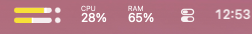

# MenuMeter

A tiny, free stereo level meter for the macOS menu bar. It shows how loud everything your Mac is playing is, live, with two slim bars — one per channel.



- **Whole-system audio** — meters every app at once, on whatever output you're using (speakers, headphones, AirPods). Switches automatically when you change output.
- **No extra drivers** — uses the Core Audio process taps built into macOS 14.2+. Nothing like BlackHole or Loopback needed.
- **Peak hold and clip lights** — a thin line marks each channel's recent peak, the tip of the bar glows orange-red above −4 dB, and the dot at the end lights red for two seconds when a channel hits 0 dB.
- **Colours** — Yellow, Green, Blue, Pink, your system accent colour, or Monochrome. Adapts to light and dark menu bars.
- **Open at Login** — one click in the menu.
- **Nothing is recorded** — audio is only measured to draw the meter, never stored or sent anywhere.

## Requirements

macOS 14.2 (Sonoma) or later.

## Install

### Download

1. Download `MenuMeter.zip` from the [latest release](../../releases/latest) and unzip it.
2. Move `MenuMeter.app` to your Applications folder.
3. The app isn't notarized by Apple, so the first time, **right-click it and choose Open**, then confirm. If macOS says the app is damaged, clear the download flag instead:

   ```bash
   xattr -dr com.apple.quarantine /Applications/MenuMeter.app
   ```

4. When asked, allow MenuMeter to record system audio. This is how it measures levels; without it the meter stays empty. You can change this later in **System Settings → Privacy & Security → Screen & System Audio Recording**.

### Build from source

Needs the Xcode Command Line Tools (`xcode-select --install`).

```bash
git clone https://github.com/bassepeder/MenuMeter.git
cd MenuMeter
./build.sh
ditto MenuMeter.app /Applications/MenuMeter.app
open /Applications/MenuMeter.app
```

## Usage

Click the meter for the menu: choose a **Color**, turn on **Smooth Animation (60 fps)** or **Open at Login**, or **Quit**. To move the meter, hold ⌘ and drag it; macOS remembers the spot.

MenuMeter is cheap to run: about 2% of one CPU core while audio plays at 30 fps (3% at 60 fps), and close to nothing when it's silent. It moves Core Animation layers instead of redrawing, because every redraw makes macOS re-render a copy of the menu bar item for each display.

## Customizing

Everything lives in [`main.swift`](main.swift):

- **Size and position** — `barWidth`, `barHeight`, `gap`, `dot` and `verticalOffset` in `MeterView`.
- **Colours** — the `MeterColor` enum.
- **Scale and movement** — `floorDB` (the bottom of the scale, −40 dB by default), the release speed and peak-hold time in `Channel.update`.

Run `./build.sh` again after any change. Each rebuild is a new ad-hoc signature, so macOS asks for the audio permission again.

## How it works

MenuMeter creates a private, global stereo [Core Audio process tap](https://developer.apple.com/documentation/coreaudio/capturing-system-audio-with-core-audio-taps), wraps it in a private aggregate device clocked by your current output, and reads the peak level of each channel on the audio thread. The menu bar view redraws 30 times a second with fast attack, smooth release (about 24 dB/s) and a 1.2-second peak hold.

The look is inspired by the menu bar meter in Rogue Amoeba's Audio Hijack. MenuMeter is not affiliated with Rogue Amoeba.

## License

[MIT](LICENSE)
